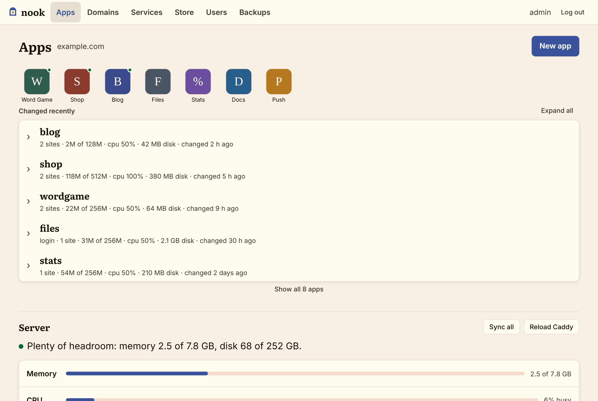
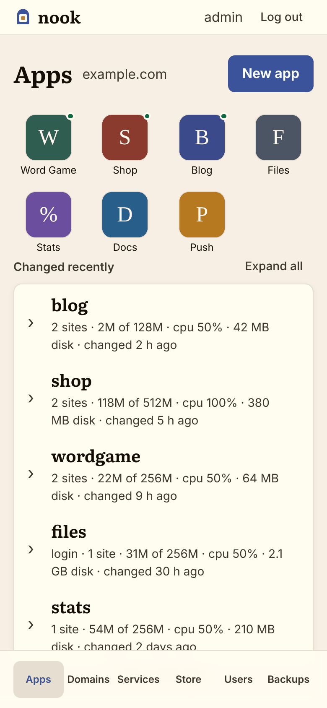
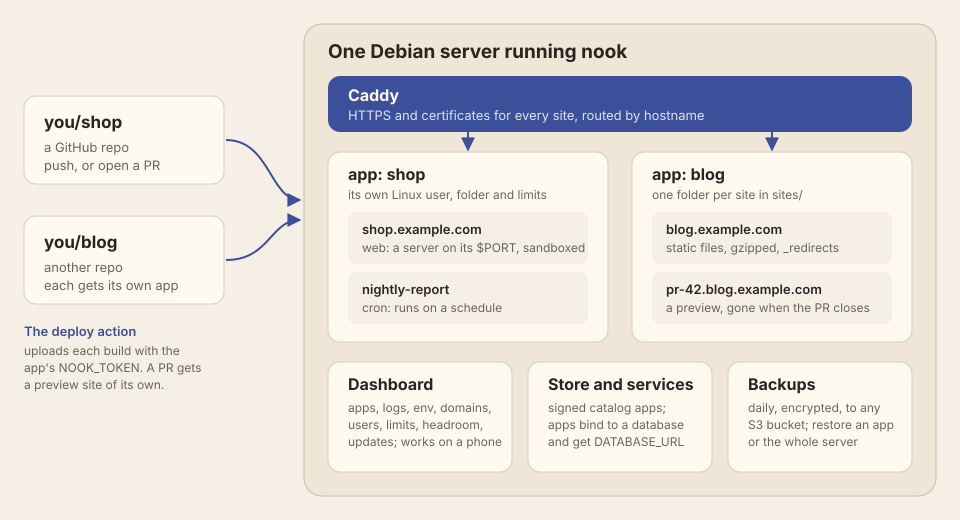
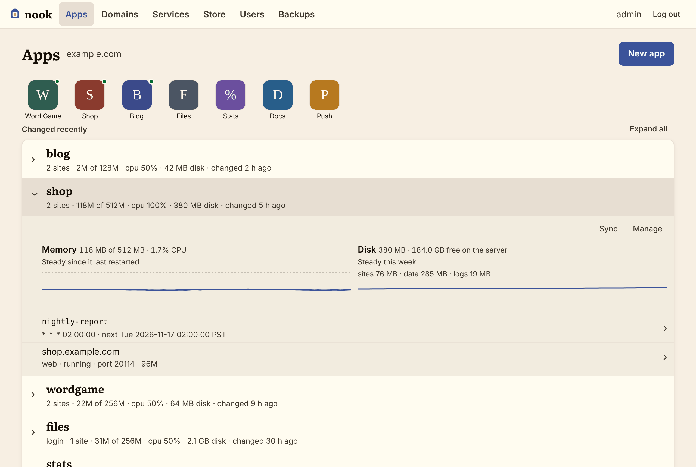
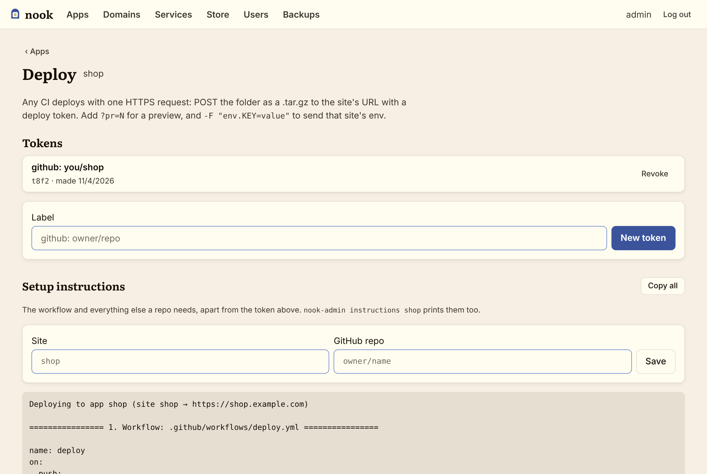
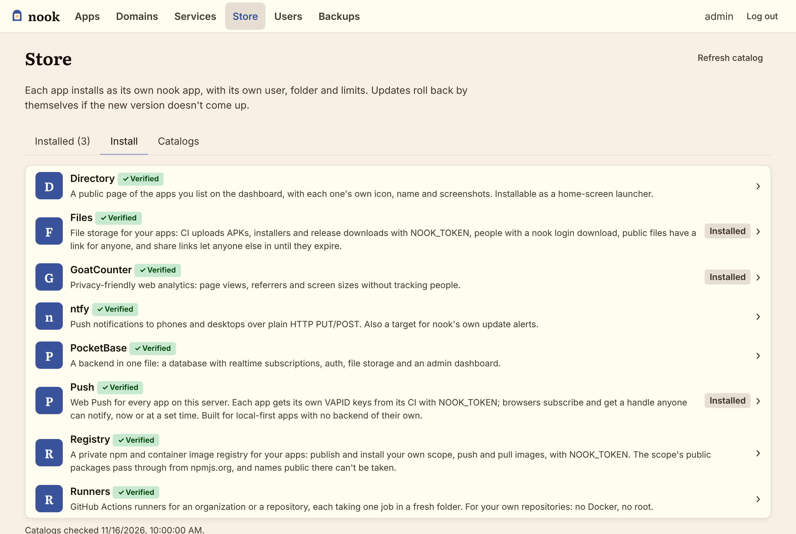
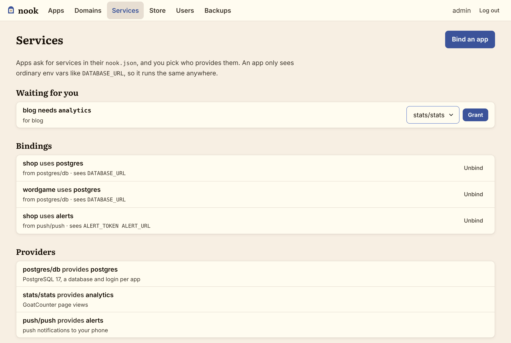
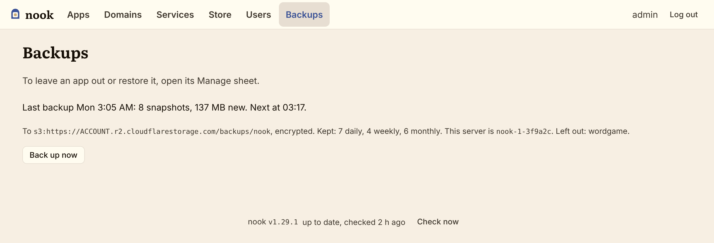
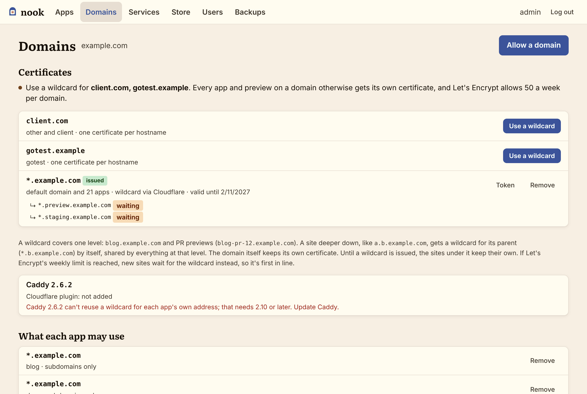

# nook

**Your own app host, on one small server.** nook runs static sites, web apps, background services and cron jobs on a single Debian VPS. Push to GitHub and it's live over HTTPS, every pull request gets its own preview, and a dashboard that works on your phone shows what everything is doing.

**[Website and docs](https://nook.sparkstonepdx.com)** · [Install](#install) · [Changelog](CHANGELOG.md)

<p>
  
  
</p>

## What you get

- **Deploy from any repo.** A GitHub Action (or one `curl` from any CI) uploads your build with a deploy token. Static files, a server on `$PORT`, a background service or a cron job, all from the same folder layout.
- **Every app on its own.** Each repo gets its own Linux user, folder, memory and CPU limits, firewall rules and systemd sandbox, so one app can't read or starve another.
- **Previews for every pull request,** at their own address, gone when the PR closes.
- **A dashboard you can run from your phone:** sites and their health, logs, environment and secrets, domains and certificates, users, memory and disk over time, and one-tap updates.
- **A store of ready-made apps** (analytics, file storage, push notifications, a private npm and container registry, CI runners), signed and pinned by hash, each installed as an ordinary app.
- **Shared services by name.** An app asks for `postgres`; you pick who provides it; the app just sees `DATABASE_URL`.
- **Backups** to any S3-compatible bucket, encrypted and incremental, with one-app and whole-server restores.

Two static Go binaries and Caddy. No containers, no database to run, no account anywhere.

## How it works



## A look around

| | |
|---|---|
|  **An app, opened:** memory and disk over the week, and each site's state. |  **Deploy:** a token and a ready-made workflow for the repo. |
|  **Store:** apps from signed catalogs, each its own nook app. |  **Services:** which app provides what, and who uses it. |
|  **Backups:** daily, before each update, and on demand. |  **Domains:** which app may use which domain, and the DNS to set. |

## Sites and apps

Run apps and static sites on one Debian box behind Caddy, deployed from GitHub. Each repo gets an isolated app (its own Linux user and folder); every folder in its `sites/` is a live site, named by its hostname.

```
/srv/nook/<app>/sites/blog/              ->  https://blog.<default domain>
/srv/nook/<app>/sites/client.com/        ->  https://client.com   (+ www.client.com redirecting to it)
/srv/nook/<app>/sites/pr-12.client.com/  ->  https://pr-12.client.com
    index.html, 200.html, 404.html       static site (200.html = SPA fallback, 404.html = not found)
    run (executable)                     something that runs (sandboxed, as the app's user); nook.json picks the kind
```

| Kind (`nook.json`) | What `run` is | Gets |
|---|---|---|
| `web` (default, no `nook.json` needed) | an HTTP server on `$PORT` | the site's hostname, routed by Caddy |
| `service` | a long-running server on `$PORT`, like a database | a port only: no hostname, no route; only its own app can reach it (other apps once bound, #12) |
| `cron` | a job: `{"kind": "cron", "schedule": "*/15 * * * *", "timeout": 600}` | runs on the schedule; no port, no hostname |

- **Schedules** can be 5-field cron, `@daily`-style shorthands, or a systemd calendar expression. Cron's "day of month OR day of week" combination is refused rather than silently changed.
- **What every kind gets:** all three get the same env scopes, logs and sandbox.
- **Health checks:** a web site or service can name a path that answers under 400 when it's working: `{"health": "/healthz"}`. After a deploy, nook waits up to 60 s for it, and the deploy API reports `healthy`; the action fails the job if it isn't. The dashboard asks it every time it loads, with a 2 s limit, and shows **unhealthy** with the reason on that site. It's asked on the site's port with its hostname, as Caddy sends it.
- **Nook login:** an app's **Nook login** switch (Apps, Manage, or `nook-admin login APP on`) puts every site of the app, static or running, PR previews too, behind the dashboard's login. Someone opening a page is sent to the dashboard's address to log in, then straight back; each site then has its own cookie for 30 days. Admins and users given that app get in; a password change, a removal or a lost app ends their access at the next request. The site gets `X-Nook-User` (who it is; a client can't send its own), or `X-Nook-App` for a deploy token; the one that doesn't apply arrives empty, so treat empty as absent. A running site can ask for this itself with `{"auth": "nook-login"}` in its `nook.json` (or a catalog entry): its sites then always need a login or a deploy token, with `"open"` paths as above, and the switch shows on and can't be turned off. Until the dashboard's address is set, such a site is token-only, never open. Deploy tokens still get in as on token-only sites, so scripts keep working, and `"open"` paths still skip the check. `/.nook/logout` on the site logs out. It needs the dashboard's address set.
- **Users:** admins see the whole dashboard. A user invited for **only some apps** sees no dashboard, just a launcher of those apps' sites and their password; change it any time with **Access** on the Users page.
- **Token-only sites:** a web site with `{"auth": "nook-token"}` only lets in requests carrying a deploy token from this server, as `Authorization: Bearer <token>` or as the password of Basic auth (what `docker login` sends; any username). Caddy asks nook to check the token before the request reaches the site, then passes the request on without the token and with `X-Nook-App` set to the app the token belongs to. A client can't send its own `X-Nook-App`. Paths listed in `"open"` (`{"auth": "nook-token", "open": ["/v1/health", "/v1/send/*"]}`, up to 20, `*` only at the end) skip the token check, for callers that can't hold a token, like browsers. They get no `X-Nook-App`, and `Authorization` is still removed. Requests without a good token get a 401 that asks for Basic auth. The health check is asked on the site's port directly, so it doesn't need a token. Each app's CI already has `NOOK_TOKEN`, so a private registry or API for your own apps needs no new secrets.
- **Listening on other ports:** a running site may only listen on its own `$PORT`. With `{"listen": "any"}` in `nook.json` (or `"listen": "any"` in a catalog entry) it may also listen on any port from 1024 up, except nook's app range (20000–29999 by default), so it still can't take another app's port. For CI runners, whose jobs start test servers on ports of their own. nook doesn't firewall inbound traffic, so such a port is reachable from outside unless your VPS firewall blocks it.
- **CORS for static sites:** a static site (no `run`) with `{"cors": true}` in its `nook.json` answers with `Access-Control-Allow-Origin: *`, so pages on any domain can fetch its files (a config file other sites read, say). Off by default. A static site's `nook.json` is never served: it stays in the app's folder and is left out of the published copy. Running sites set their own headers.
- **Compression for static sites:** when a static site is published, nook writes a gzip copy (`name.gz`) beside each HTML, CSS, JS, JSON, SVG, WASM and similar text file of 1 KB or more that it shrinks by at least a tenth, and Caddy sends those to browsers that accept gzip. No compressing on each request. A `.gz` the upload brought beside one of its own files is replaced; a `.gz` with no file beside it (a download) is served as it is. Sites published before this get theirs at their next deploy.
- **404 page:** a static site without its own `404.html` shows the server's 404 page for paths it doesn't have. Edit it on the dashboard's Domains page (one self-contained HTML file, up to 256 KB); it takes effect right away, and Restore default puts nook's back. It lives at `/etc/caddy/nook-404/404.html`. Unknown hostnames still get `/etc/caddy/catchall/index.html`.
- **Redirects for static sites:** a `_redirects` file in the site folder works as on Netlify and Cloudflare Pages: `from to [status]` a line, `#` comments. 200 serves `to` at `from` (a rewrite, such as `/sync /sync.html 200`); 301 (the default), 302, 303, 307 and 308 redirect. `:name` matches a path segment and a trailing `*` the rest (`:splat`), and both can be used in `to`. The first matching rule wins, and a rule is skipped when a file exists at the path unless its status ends in `!`. Conditions, query matches and proxying (200 to another site) aren't supported: those lines are skipped, and the sync log says why. Up to 500 rules; `/_redirects` itself is never served.
- **Cron jobs:** a run that's still going after `timeout` (default 1 hour) is stopped. Runs missed while the server was down happen at the next boot. The dashboard shows the last result and the next run, and **Run now** (or `nook site restart NAME`) runs one immediately.

Two static Go binaries, no runtime dependencies:

- **`nook-admin`** (root, and the dashboard's own user): install, create/delete apps, sync, grants, env, invites, updates, the dashboard.
- **`nook`** (everyone): `nook site deploy|rm|restart|list|logs`. It only ever acts as whoever runs it.

## Install

On a fresh Debian 13 VPS, as root:

```sh
curl -fsSL https://raw.githubusercontent.com/sparkstonepdx/nook/main/setup-server.sh | sh   # public repo
# or, while private: git clone the repo, cd into it, sh setup-server.sh  (builds from source)
```

That installs Caddy, swap, both binaries, and runs `nook-admin install`, which prints a one-time setup link: `https://<server ip>:8443/invite?...` (self-signed; accept the warning). Create your login, then on the Domains page set the dashboard's address and grant domains to apps. Open ports 22, 80, 443 (tcp + udp) and 8443.

Copying the two binaries onto a box and running `./nook-admin install` does the same, minus swap.

### Coming from app-host

This project used to be called app-host. Running `nook-admin install` (or `--upgrade`) on an app-host box moves it over in place: `app-NAME` users become `nook-NAME` (same uid, files untouched), `/srv/apps`, `/etc/apps`, `/var/log/apps`, `/var/lib/app-host*` and `/etc/ssh/app-host-keys` move to their nook names, the old units, sshd and Caddy config are removed, and every app is re-synced. Existing `APP_HOST` tokens and `ssh ... app site ...` still work, so repos keep deploying; rename the secret to `NOOK_TOKEN` and switch to `sparkstonepdx/nook/deploy@v1` with `token:` when convenient. Re-run `extras/subduction-app.sh` afterwards if you use it.

## Updating

- Releases are automatic. A PR that should ship adds a changeset (`npx changeset`: patch, minor or major, plus a changelog line; see `.changeset/README.md`). When it merges, the release workflow bumps the version, writes `CHANGELOG.md`, commits that to main, then tags, builds both architectures, signs `checksums.txt` with ed25519 and publishes the release with those notes. PRs without a changeset release nothing. One-time setup: `scripts/setup-release-key.sh`.
- Servers: `nook-admin update` verifies the signature against the key built into the running binary, swaps both binaries, runs the install step again, and restarts the dashboard. Running sites are not touched.
- Notifications: a daily check shows "update available" on the dashboard (with an Update button) and in the SSH login message, and posts to `UPDATE_NOTIFY_URL` (ntfy, Discord or Slack) if set in `/etc/nook/update.env`.
- While the repo is private the server needs a read-only `GITHUB_TOKEN` in `/etc/nook/update.env`.

## Dashboard


Apps and sites (state, port, memory, live or not), create/delete, sync, restart/stop/start, remove sites, logs, environment, domains, users, updates.

- **Split in two:** `nook-admin web` serves the UI and handles logins as the unprivileged `nook-web` user, in a tight systemd sandbox. Everything else goes over a unix socket to `nook-admin helper` (root), which accepts a fixed list of operations and checks the caller with `SO_PEERCRED`. A bug in the web side doesn't hand out a root shell.
- **Logins:** per user, scrypt-hashed; HMAC-signed session cookies (30 days). Invites are signed one-time links (24 h). Removing a user or changing a password logs their sessions out.
- **Requests:** JSON only, from the dashboard's own origin; strict CSP; failed logins throttled per client IP (5 free, then up to 60 s).
- **Reaching it:** always at `https://<ip>:8443` (self-signed), plus the address set on the Domains page.
- **Installable:** from the address on the Domains page, nook installs as an app on phones and desktops (manifest, icons, a service worker that keeps the shell but never caches `/api`). It asks from the second visit, and an open page offers Reload once nook has updated under it. The self-signed IP address can't install.
- **UI source:** `dashboard/ui` (Solid + `@sparkstone/css`), built into `dashboard/public` and embedded in the binary. Change it with `cd dashboard/ui && npm install && npm run dev` (proxies `/api` to `/tmp/nook-web.sock`; serve one there with `systemd-socket-activate -l /tmp/nook-web.sock nook-admin web` as the `nook-web` user), then `npm run build` and commit `dashboard/public`. CI fails if it's stale.

## Deploying

Any CI deploys with one HTTPS request to the dashboard's address: POST the folder as a `.tar.gz`, with a per-app deploy token.

```sh
tar -C dist -czf site.tgz .
curl --fail-with-body -sS -H "Authorization: Bearer $NOOK_TOKEN" -F site=@site.tgz https://admin.example.com/api/v1/sites/blog
```

| Request | Does |
|---|---|
| `POST /api/v1/sites/SITE` | publish; the body is the `.tar.gz`, raw or as multipart field `site` |
| `POST /api/v1/sites/SITE?pr=12` | publish the preview `SITE-pr-12` (or `pr-12.client.com` for a hostname) |
| `-F env=@prod.env`, `-F "env.KEY=$VALUE"` | in the same POST: replace that site's "sent by deploys" env (see Runtime environment) |
| `DELETE /api/v1/sites/SITE?pr=12` | remove the preview (or a site, without `pr`) |
| `POST /api/v1/env[?site=SITE]` | set env without deploying (below) |
| `GET /api/v1/whoami` | which app the token deploys |

- **SITE:** `blog` means `blog.<default domain>`. `client.com` means exactly that hostname, which needs a grant.
- **Responses:** JSON `{app, site, url, live, kind, output}`. A deploy that didn't go live (not granted, reserved or taken) answers `409`, so `curl --fail-with-body` fails the job.
- **What an upload may contain:** only plain files and folders. Symlinks, devices and paths outside the folder are refused, and the previous build stays up.
- **Tokens carry the address:** a token is `nook:` then the dashboard's address, then the secret: `nook:admin.example.com/AbC…`. The action needs only the secret. Tokens from nook 1.6 (`nook_admin.example.com/AbC…`) still work as they are; older ones (`nook_AbC…`) need the action's `url` input. A token keeps the address it was made with; if the dashboard moves, make a new one or pass `url`.
- **Tokens:** make and revoke them on the dashboard's **Deploy** page (it also shows a ready-to-paste workflow) or with `nook-admin token create APP`. A token is shown once; the server keeps only its SHA-256. Wrong tokens are throttled like logins.
- **How it works:** the dashboard (unprivileged) spools the upload to an unlinked file and hands the open file to the root helper. The helper checks the token and unpacks the file as the app user. Root never opens a path the upload chose.

`nook-admin create` prints the token and complete setup instructions: a curl-only workflow (push deploys, PR previews, cleanup on close), the action alternative, what to publish, env and services. Get them again any time on the app's **Deploy** page or with `nook-admin instructions APP [--site S] [--repo OWNER/NAME] [--new-token]`. For a PR comment with the preview URL and an HTTPS check, use the action instead:

```yaml
- uses: sparkstonepdx/nook/deploy@v1
  with:
    token: ${{ secrets.NOOK_TOKEN }}   # carries the server's address
    site: myapp        # or a hostname like client.com (needs a grant)
    dir: dist          # an executable "run" inside makes it a running app
    env: |             # optional, from secrets
      DATABASE_URL=${{ secrets.DATABASE_URL }}
```

- **Previews:** pull requests deploy a preview, comment its URL on the PR, and remove it when the PR closes. Turn that off with `previews: "false"`.
- **Outputs and permissions:** the outputs are `url` and `site`. The PR comment needs `permissions: pull-requests: write`.
- **Pinning:** pin `@v1` (moved on each release) or a commit SHA, never `@main`.
- **What the action is:** a small Go program in this repo (`cmd/deploy-action`, standard library only), built on the runner.
- **Older tokens:** `nook1:` tokens (SSH deploy keys, from before the deploy API) still work with the action, through the SSH gate.

### Secrets from CI

`POST /api/v1/env` sets env from CI without deploying.

- **Write-only:** nothing can read values back, and they're never logged.
- **Where they go:** with no `site`, into the app's "sent by CI" values, which every site loads; your dashboard values for the whole app still win. With `?site=SITE`, into that site's deploy values.
- **Body:** a `.env`, JSON `{"KEY": "value"}`, or `-F env.KEY=value`.
- **Options:**
  - **Replace by default:** the scope ends up holding exactly what you sent.
  - `?merge=1` adds instead of replacing.
  - `?unset=A,B` removes those keys.
  - `?prefix=PROD_` keeps only `PROD_*` names, minus the prefix.
- **Dropped:** `GITHUB_TOKEN`, `NOOK_TOKEN`, nook's own names, invalid names, and multi-line values. Multi-line values can't go in an env file; keep certificates and keys as files in `data/` instead. The response lists what was skipped.

Push every repo secret named `PROD_*`:

```yaml
- env:
    SECRETS: ${{ toJSON(secrets) }}
  run: |
    printf '%s' "$SECRETS" | curl --fail-with-body -sS -H "Authorization: Bearer $NOOK_TOKEN" \
      -H 'Content-Type: application/json' --data-binary @- "https://admin.example.com/api/v1/env?prefix=PROD_"
```

## Runtime environment

Env vars and secrets for running apps live on the server under `/etc/nook/env/` (root-only), in scopes:

| Scope | Set with | Loaded into |
|---|---|---|
| whole app | dashboard (app → Environment) or `nook-admin env set APP KEY` | every running site of the app |
| site | `--site SITE` | that site only |
| previews | `--previews SITE` | every PR preview of that site, not the site itself |
| sent by CI | `POST /api/v1/env` | every running site (before the whole-app values, so yours win) |
| sent by deploys | the deploy request (`-F env=...`) or `POST /api/v1/env?site=SITE` | that site |

- **Load order:** a running site loads, later wins: the app's own `secrets.env`, then the whole app, then previews (previews only), then sent by deploys, then its site scope.
- **Previews:** they never get their base site's own values, so production secrets stay out of PR builds unless you put them in the app or previews scope.
- **Saving:** restarts the running sites that load that scope.
- **The app's own `secrets.env`:** if the app's deploys write one into its folder, `nook-admin sync` copies it, reading it as the app user.
- **Set by nook:** `PORT`, `HOST`, `SITE` and `SITE_HOST`, which can't be overridden.

## Services

Apps ask for shared services by name in `nook.json` (`"needs": ["postgres"]`), and you bind each one to a provider on the dashboard's **Services** page or with `nook-admin bind APP SERVICE`.

- **What the app sees:** only conventional env vars, so it has no nook-specific code and runs the same on Kubernetes with the same vars from Secrets.
- **Renames:** `--as DATABASE_URL=PG_URL` renames a var for an app that already uses its own names.
- **Restarts:** binding or unbinding restarts the app's running sites.

| Service | App sees | Providers |
|---|---|---|
| `postgres` | `DATABASE_URL` | any app that provides it |
| `email` | `SMTP_URL` | (coming: the SES gateway) |
| `alerts` | `ALERT_URL`, `ALERT_TOKEN` | any app that provides it |
| `analytics` | `ANALYTICS_URL`, `ANALYTICS_TOKEN` | any app that provides it |
| `s3` | `S3_ENDPOINT`, `S3_BUCKET`, `AWS_ACCESS_KEY_ID`, `AWS_SECRET_ACCESS_KEY` | any app that provides it |

**An app as a provider:**
- **Declaring it:** a site of kind `service` declares what it implements:
  ```json
  {"kind": "service", "provides": {"alerts": {"desc": "posts to Discord", "env": {"ALERT_URL": "{url}/alert", "ALERT_TOKEN": "{token}"}}}}
  ```
- **What each binding gets:** `{url}` (`http://127.0.0.1:PORT`), `{host}`, `{port}`, and its own `{token}`.
- **Who may call it:** the provider learns its callers from `NOOK_CLIENTS` (`{"alerts": {"blog": "<token>"}}`).
- **Firewall:** opens the provider's port to exactly the bound apps.
- **Known services:** known names (above) must provide exactly their env names, so providers are interchangeable. Any other name is a new interface that its provider defines.
- **Versions:** a provider states `"version": "17"`. A consumer can ask for `"postgres>=15"` or `"php@8.3"` (8.3 or 8.3.x, not 8.30). Binding refuses a provider that doesn't meet it, and with no provider named, nook picks the newest one that does.
- **Provisioning:** `"provision": "./provision.sh"` runs when an app is bound, as the provider's user in its site folder, with the app's name as its argument and in `NOOK_CONSUMER`, plus `NOOK_CONSUMER_USER` (its OS user, for Postgres peer auth) and `NOOK_CONSUMER_UID`. It sets up what that app needs (a role, a database) and prints `KEY=value` lines for the interface's env names, which the app gets in place of the templates. `"deprovision": "./deprovision.sh"` runs when the binding goes (unbound, moved to another provider, or the app deleted); data is the provider's to keep or drop. A failed provision leaves no binding.
  ```json
  {"kind": "service", "provides": {"postgres": {"version": "17", "env": {"DATABASE_URL": ""}, "provision": "./provision.sh", "deprovision": "./deprovision.sh"}}}
  ```

**Optional services:** `"needs": ["notify?"]` is used when bound and never blocks anything: installing says the app can use it, and the Services page only asks about it once something provides it.

**Providers that work on static sites:** a static site can list `needs` in its `nook.json` too. A provider bound to it can then work on the site itself, which is how a form catcher handles plain HTML forms:
- **Publish hook:** `"publish": "./publish.sh"` runs on every publish of the site, before it goes live. It gets the site's `*.html` and `*.htm` files (or `"publish_files": ["*.svg"]`, up to 10 name patterns) as a tar on stdin, with `SITE`, `NOOK_CONSUMER` (the site's app), `NOOK_INTERFACE` and `PORT`, as the provider's user in its site folder. It writes a tar of only the files it changed to stdout; it can't add files or change any it wasn't sent. What it prints on stderr goes into the deploy log. If it fails or runs past 2 minutes, the publish fails and the previous copy stays live. Binding or unbinding publishes the site again.
- **POSTs:** `"posts": true` sends the site's POST requests to the provider, with the original path and query, the site's `Host`, and `X-Nook-Site: APP/HOST` (a client can't send its own). Everything else is served as before; a static site couldn't take a POST anyway.
- **Env:** a provider that only publishes or takes posts needs no `env`.
  ```json
  {"kind": "service", "provides": {"formcatch": {"publish": "./publish.sh", "posts": true}}}
  ```

**Runtimes:** binaries other apps run as themselves, like PHP or FrankenPHP, never a shared process. A site without `run` whose `nook.json` says `"kind": "runtime"` is one:
- **Published, not served:** nook copies the folder root-owned to `/var/lib/nook/runtimes/APP/SITE` on each deploy and never runs it or gives it an address.
- **What it provides:** each interface it provides has a `version`, a `bin` folder inside it (default `.`), and optionally `links` to what apt installed under `/usr`, which nook adds to the copy:
  ```json
  {"kind": "runtime", "provides": {"php": {"version": "8.3", "links": {"php": "/usr/bin/php8.3"}}}}
  ```
- **Using one:** an app asks for it like any service, `"needs": ["php@8.3"]`. Its sites, cron jobs and hooks get the runtime's bin folder first on `PATH` and in `NOOK_RUNTIME_BIN` (the first runtime's, by name, when there are several). `{bin}` in the runtime's `env` templates is that folder.
- **Updates:** apps bound to a runtime restart when it's published again.

## Public ports

A running site can listen on the server's own ports itself, not through Caddy, the way a mail server takes 25, 465, 587 and 993.
- **Asking:** the site's `nook.json` says `"ports": [25, 465, 587, 993]` (web sites and services, up to 10, TCP).
- **Granting:** an admin allows them on the app's **Manage** sheet or with `nook-admin ports APP grant 25,465,587,993` (`revoke` takes them away; `nook-admin ports APP` lists them). Until then the deploy log and the Manage sheet say what it asks for.
- **What changes:** only that one unit may bind the ports both asked for and granted, and for a port under 1024 it gets the one capability that binds it (`CAP_NET_BIND_SERVICE`). Everything else about its sandbox stays as it was.
- **Never granted:** 22, 53, 80, 443, 2019 (SSH, DNS, Caddy, Caddy's admin API) and nook's app port range. A port is granted to one app at a time.
- **Firewall:** nook doesn't manage inbound rules; if your provider or `ufw` filters them, open the ports there too.

## Store

The dashboard's **Store** page installs ready-made apps from signed catalogs. Each one becomes an ordinary nook app with its own user, folder, limits and firewall rules.

- **Official catalog:** [sparkstonepdx/nook-catalog](https://github.com/sparkstonepdx/nook-catalog), signed with a key compiled into nook. Its apps show a green **Verified** check.
- **Community catalogs:** add one under **Catalogs** by its repo (`owner/repo`) or URL. Its key is read when you add it and pinned, so a later key change is refused. Every app from it names the catalog it came from, and installing one says it isn't the official catalog.
- **Trust:** every catalog pins each download's sha256. A bad signature or hash stops the install.
- **Apps from apt** (official catalog only, since apt runs package scripts as root): an entry can name Debian packages instead of a release binary, from Debian or from a third-party repository the signed catalog defines once and pins by its key's fingerprint (written as that repository's own keyring, so it vouches for nothing else). apt supplies the files; nook masks the distro's own service and runs the program as an ordinary app. Entries with majors (`"versions": ["16", "17"]`) install each major as its own app (`postgres-17`), so two can run side by side; apt's updates within a major follow the app's update policy, and a failed health check afterwards is reported, not rolled back (apt can't go back reliably).
- **App pages:** each app has a page with its screenshots, details, the settings it asks for, and links to the original project's homepage and source. Icons and screenshots are pinned by hash too. The helper fetches them, checks the hash and keeps a copy, so the dashboard serves them from its own address and your browser never contacts the catalog.
- **Updates:** each app has a policy: `off`, `notify`, `patch`, `minor` (default) or `all`. The nightly check applies allowed updates from the catalog the app came from, and notifies about the rest.
- **Rollback:** after an update nook health-checks the app. If it doesn't come up, nook redeploys the previous version, notifies you, and skips that version from then on.
- **Running a catalog:** see the nook-catalog README. Copy the repo, swap in your apps, and run its key script.

```
nook-admin store list [--refresh]
nook-admin store catalogs [add OWNER/REPO|URL | rm ID]
nook-admin store install ID [--catalog C] [--app NAME] [--site SITE] [--policy P] [--env K=V]
nook-admin store update APP [--force]
nook-admin store policy APP off|notify|patch|minor|all
```

## Domains


- **Default domain** (`BASE_DOMAIN`): site folders without a dot are subdomains of it.
- **Grants**, per app, in `/etc/nook/grants`:
  - `domain client.com`: `client.com` and every `*.client.com`
  - `sub client.com`: `*.client.com` only (use this for a shared domain)
  - `host blog.client.com`: exactly that hostname

  New apps get `sub <default domain>`. Several apps can share a domain; the first to publish a hostname keeps it.
- A root domain an app owns (`domain` or `host` grant) with no `www.` folder gets `www.` redirecting to it. A real `www.` site in any app replaces the redirect.
- The Domains page lists the DNS records each grant needs.
- **Certificates:** by default Caddy gets one certificate per hostname, and Let's Encrypt allows 50 a week per registered domain, which apps plus PR previews run into. Domains → Certificates sets up a wildcard (`*.domain`, by DNS challenge) for the default domain and each `domain`/`sub` grant:
  - Pick the DNS provider (Cloudflare for now) and paste an API token from the "Edit zone DNS" template, scoped to that zone. nook checks the token can see the zone before saving it to `/etc/nook/dns.env` (root-only), and gives it to Caddy through a systemd drop-in.
  - Caddy needs the provider's plugin. Debian's Caddy can't add plugins, so the page downloads the current Caddy with it from caddyserver.com (the build server `caddy add-package` uses), checks it runs, lists the module and accepts your config, swaps it in for `/usr/bin/caddy` (keeping the old one as `caddy.nook-old`) and holds the package so apt can't put a plugin-less Caddy back. Update Caddy does the same with the same plugins.
  - Caddy 2.10+ uses the wildcard for every app's hostnames by itself (older Caddy, like Debian's 2.6, still gets one per hostname; the plugin step installs a current Caddy).
  - Until the wildcard is actually issued (a rate limit can hold it for days), every hostname under it keeps its own certificate (`tls force_automate`); the helper checks Caddy's certificate store every 2 minutes and moves them onto the wildcard once it's there. The dashboard address always keeps its own certificate, so a wildcard can't lock you out.
  - A wildcard covers one level: `blog.example.com` and previews (`blog-pr-12.example.com`). A site deeper down, like `a.b.example.com`, gets a wildcard for its parent (`*.b.example.com`) automatically, through the same provider and token and shared by everything at that level; it's worked out from the published sites on each sync, so it goes away with its last site. The domain itself keeps its own certificate.

## Catch-all page

Any hostname that points here but isn't a site (or the dashboard) gets a plain 404 page on `http://`. Known sites still redirect to HTTPS, and `http://<ip>` redirects to the dashboard on `:8443`. Edit the page at `/etc/caddy/catchall/index.html`; `nook-admin install` never overwrites it, and removes Debian's stock `:80` welcome-page block from `/etc/caddy/Caddyfile` (keeping a backup), because two `:80` sites can't coexist.

Over `https://`, an unknown hostname fails the TLS handshake instead, because Caddy only has certificates for names it serves.

## Directory

Every site on the server, with its own name, icon and colors, read from its web manifest and its page's meta tags.

- **Launcher:** the top of the dashboard's Apps page is a tile per site; one tap opens it. Each tile shows what Android shows for an installed PWA: the manifest's maskable icon filling it, else the app icon on the site's background color, else its favicon, else its initial. Listed sites come first, then sites with a manifest, then sites with an icon, then the rest; PR previews are left out. The first 8 show, with **Show all**.
- **Listing:** **List in directory** on a site's sheet (or `nook-admin directory add|rm HOST`) puts it in the public list, in the order listed. The list is `/etc/nook/directory.json`.
- **Public list:** `GET /api/v1/directory` on the dashboard address (no login, CORS open) gives the listed sites: host, URL, name, short name, description, theme and background colors, icon, screenshots, share image (`image`, from `og:image`) and whether it's installable. Icons are served at `/api/v1/directory/icon/NAME`. The Directory app in the catalog shows this list as a page anyone can visit.
- **Cards:** nook-web reads each site's page and manifest from Caddy on the same machine and keeps them an hour (a site it couldn't reach, a minute). The page's Open Graph and Twitter tags give the share image, and a description or name the page doesn't otherwise have.
- **Icons:** the manifest's, then the page's `<link rel="icon">` and `apple-touch-icon`, then `/apple-touch-icon.png`, `/favicon.svg` and `/favicon.ico`, the first that's really an image (a single-page app answers every path with its page). A site that doesn't answer `/` with a page, like a token-only API, still gets its favicon. A store app that serves no icon gets its catalog icon. Only the site's own URLs are used for icons and screenshots, colors that aren't plain CSS colors are dropped, and icons (PNG, JPEG, WebP, GIF, ICO, SVG up to 512 KB) are kept in `/var/lib/nook-web/directory-icons`. SVGs are served so they can't run script.
- **Catalog env:** a catalog entry's env default can use `{dashboard_url}`, the dashboard's `https://` address.

## Backups

Daily, before each nook update, and on demand, nook backs up to an S3-compatible bucket (Cloudflare R2, Backblaze B2, any S3) with [restic](https://restic.net): encrypted, deduplicated, incremental. Set it up on the dashboard's **Backups** page, or `nook-admin backup setup --repo s3:https://ENDPOINT/BUCKET/nook --key KEY_ID` (the secret on stdin).

- **What's in it:** one snapshot of the server (`/etc/nook`, the dashboard's users, nook's state, Caddy's certificates, deploy keys, each app's limits, and each app's uid), and one per app (`/srv/nook/APP`, less `builds/` and what it leaves out). The backup password file itself stays out.
- **Running apps:** a site's `nook.json` `{"backup": {"run": "./backup.sh"}}` runs first, as the app user with the site's environment and `NOOK_BACKUP=1`, to write a consistent dump into `data/` (`sqlite3 .backup`, `pg_dump`). An app with no hook is frozen (its cgroup paused; nothing restarts) while it's read.
- **Leaving things out:** `{"backup": {"skip": ["data/cache"]}}` in a site's `nook.json` (paths under the app's home), or the **Back up** switch on an app's Manage sheet (`nook-admin backup skip APP on`) for the whole app.
- **Password:** made at setup and shown once; keep it somewhere other than the server. nook keeps it in `/etc/nook/backup.env` (0600) so scheduled backups run unattended. Connecting to an existing repository (another server's, or this one's before a reinstall) takes its password instead.
- **Kept:** 7 daily, 4 weekly, 6 monthly (`BACKUP_KEEP`). A sample is read back weekly (`restic check --read-data-subset=5%`). A failure is advice on the Server page and a push.
- **Several servers, one bucket:** each server has an id (`/etc/nook/server-id`), its snapshots' restic host. A server forgets and prunes only its own, and `nook-admin backup snapshots APP --from SERVER` lists another server's, the start of moving and adopting apps between servers.
- **Restoring an app:** **Restore from a backup** on its Manage sheet, or `nook-admin backup restore APP [SNAPSHOT]`. Its `data/` comes back from the snapshot and it restarts; what was there is kept as `data.before-restore-TIME`. restic writes into a root-only folder first and ownership is set there, so nothing the app can touch is written through.
- **Restoring a whole server:** on a fresh install, connect to the same repository, then restore:

  ```sh
  nook-admin backup setup --repo s3:https://ENDPOINT/BUCKET/nook --key KEY_ID --existing   # secret, then password, on stdin
  nook-admin backup restore-server [--from OLD_SERVER_ID] [--snapshot ID] [--new-id]
  ```

  It puts back the latest server snapshot (this server's own settings are kept as `/etc/nook.before-restore-TIME`; its `SSH_HOST` stays), makes each app's user with its old uid where that's free (otherwise a new one, and the files are handed over), restores every app's folder, then turns on the watchers, firewall, wildcard certificates (getting Caddy's DNS plugin if needed), the dashboard and Caddy, and syncs every app. Then point DNS at the new server; Caddy reuses its certificates. It takes over the old server's id so backups carry on the same history; `--new-id` keeps its own, for a second server while the first still runs. It refuses a server that already has apps unless `--force` (an app already here is set aside as `APP.before-restore-TIME`).
- **restic:** nook installs the version it pins (0.19.1) from GitHub's releases, checked against the SHA-256 digest GitHub publishes, at `/usr/local/lib/nook/restic`.

## Headroom

The Server section of the dashboard (and `nook-admin headroom`) says whether this server has room to spare and, if not, what to upgrade.

- **Samples:** every 5 minutes the helper records memory, swap, pressure stall (PSI) for memory, CPU and IO, each filesystem's use, and each app's memory, CPU time and OOM kills. Kept 30 days in `/var/lib/nook/stats/samples.jsonl`.
- **Memory:** tight when programs wait for memory 10% of a minute, under 5% is free, or over half of swap is used; watch at 2% or under 15% free. Advice: add RAM.
- **CPU:** tight when programs wait for CPU 25% of the time in over a quarter of the day's samples; watch at 10%. Advice: more or faster cores.
- **Disk:** tight under 10% free, under 14 days to full at the current rate, or under 5% of inodes free; watch at 20%, 60 days or 15%. Advice: more storage.
- **Apps:** an app killed for hitting its own memory limit, or using over 90% of it, gets "raise its limit" rather than "add RAM".
- **App trends:** each app's memory over the chosen range, with a line through its hourly lowest reading since it last restarted (up to 7 days; a drop under 60% of the previous hour counts as a restart). The floor is what a leak raises; short spikes don't tilt it. Growing at least 1 MB a day gives a date it reaches its own limit, or the server's memory if it has none. Under 14 days is "watch" and under 3 is "tight", in the advice, the status and the push. Each app's row on the Apps page, expanded, shows its memory, CPU over the last day, trend and a chart of the last week (memory, its limit dashed, the projection dashed); `nook-admin headroom` prints the same.
- **App disk:** everything nook keeps for each app, measured hourly: its sites and their served copies, builds, the rest of its home folder (data), logs, and store rollback copies, with hard links counted once. The expanded row shows the total, the parts over 1 MB, a chart of the week, and its growth: at least 1 MB a day gives the date the disk it's on is full at that rate. Under 30 days is "watch" and under 7 is "tight", in the advice.
- **Notifications:** a push when the overall status changes.


Root (`nook-admin`):

```
nook-admin install [--domain D] [--ip IP]
nook-admin create NAME [--memory 256M] [--cpu 50%] [--tasks 256] [--repo owner/name]
nook-admin delete NAME
nook-admin sync NAME | --all
nook-admin grant list [APP] | grant add|rm APP domain|sub|host NAME
nook-admin env list|set|unset NAME ...
nook-admin limits NAME [--memory 512M] [--cpu 100%] [--tasks 512]
nook-admin headroom
nook-admin invite
nook-admin update [--check]
```

App users, and deploy keys through the SSH gate (`nook`):

```
nook site deploy DIR SITE    # atomic swap into sites/SITE; exits 2 if SITE didn't go live
nook site deploy --move DIR SITE  # the same, moving DIR in instead of copying it (deploy API and store installs)
nook site rm SITE            # SITE: "blog" (subdomain of the default domain) or "client.com" (exact)
nook site restart SITE
nook site list
nook site logs SITE [N]
```

## What each app gets

| Path | Purpose |
|---|---|
| `/srv/nook/<app>/sites/` | one folder per hostname |
| `/srv/nook/<app>/builds/` | upload area for rsync |
| `/srv/nook/<app>/data/` | persistent data for running apps (survives redeploys) |
| `/srv/nook/<app>/secrets.env` | optional env vars written by the app's own deploys; `nook-admin env` values override them |
| `/var/log/nook/<app>/<site>.log` | output of running sites (root-owned, app-readable, rotated hourly at 10 MB) |

Running sites listen on `127.0.0.1:$PORT` and also get `$SITE`, `$SITE_HOST`, `$HOME`. Ports come from 20000–29999. Everything one app runs shares a systemd slice (default 256M memory, 50% CPU, 256 tasks; set at creation, change any time with Manage → Limits or `nook-admin limits`, no restart).

## Security model

- **App folders are `700`.** Static sites are served from a root-owned copy in `/var/lib/nook/www/`, made by `nook` running as the app user (so symlinks only reach what that app could already read); only plain files and folders are unpacked.
- **Root never opens a path inside an app's folder by name.** Directory reads use `O_NOFOLLOW` file descriptors and `*at()` calls; reading an app's own files happens as the app user. Env files, logs and deploy keys live in root-owned places.
- **Deploy tokens only deploy.** They reach nothing but the deploy API, for their own app; the token decides the app, not the request.
- **Old SSH deploy keys can only deploy.** sshd forces every `nook-*` login through `nook ssh-gate`, which allows an rsync upload into `builds/<name>/` and `nook site …`: no shell, no port forwarding, no downloads. Keys live in `/etc/ssh/nook-keys/`, which apps can't write.
- **Running sites are sandboxed.** `ProtectSystem=strict`, only their own folder visible, no new privileges, no capabilities, may only listen on their own `$PORT`, single files capped at 2 GB.
- **Apps can't reach each other's ports.** An nftables table (`/etc/nook/firewall.nft`, rewritten whenever ports change, loaded at boot by `nook-firewall.service`) lets only root, Caddy and the owning app connect to a port in the app range, including through the server's own public IP. Talk to another app through its public URL. `nook-admin firewall` reloads it. Restarting Debian's `nftables.service` flushes every table; nook's reloads right after.
- **Caddy's admin API is on a root-only unix socket**, not `localhost:2019`, so apps can't rewrite Caddy's config.
- **Updates are signed:** the binary refuses releases whose signature doesn't match its built-in key.
- **Known limits:** no per-app disk quota for `data/` (the 2 GB file cap and hourly log rotation help); the first visit to the IP dashboard trusts a self-signed certificate.

## Tested

Go unit tests cover names, grants, the Caddy config, scrypt (RFC 7914 vectors and Node's output), env files, the SSH gate, tar extraction and update verification. In a sandbox with real users, Caddy, sshd and rsync, and a stand-in for systemd: migration from the bash/Node version, login with the old password hashes, the dashboard API end to end, the deploy action through the SSH gate (push, PR preview, close, refused host), gate escapes refused, and the earlier exploits (symlinked site files, swapped `secrets.env`, symlinked `sites/`, Caddy admin access) blocked. Not tested: real systemd and a real GitHub runner.
