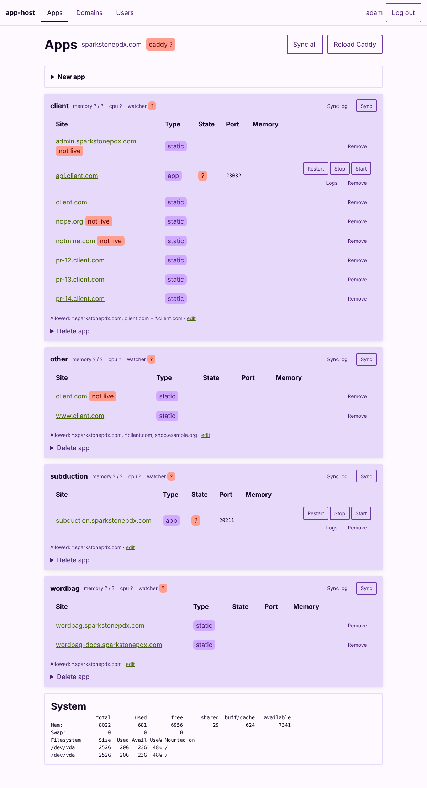
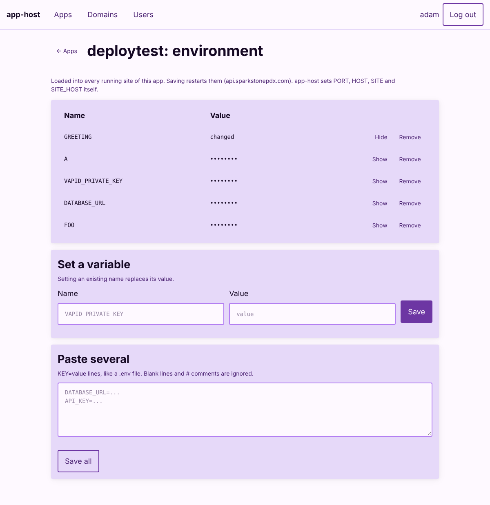
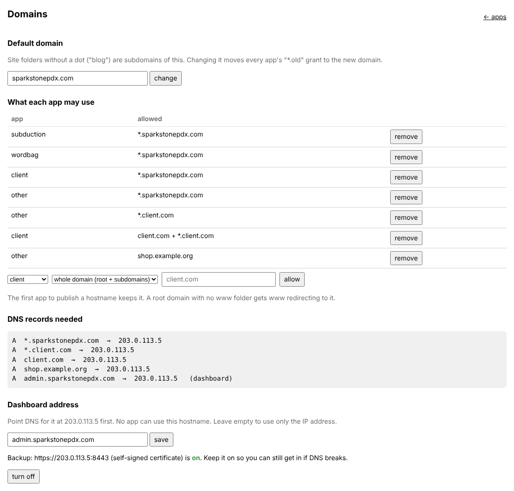

# nook

Run apps and static sites on one Debian box behind Caddy, deployed from GitHub. Each repo gets an isolated app (its own Linux user and folder); every folder in its `sites/` is a live site, named by its hostname.

```
/srv/nook/<app>/sites/blog/              ->  https://blog.<default domain>
/srv/nook/<app>/sites/client.com/        ->  https://client.com   (+ www.client.com redirecting to it)
/srv/nook/<app>/sites/pr-12.client.com/  ->  https://pr-12.client.com
    index.html, 200.html, 404.html       static site (200.html = SPA fallback, 404.html = not found)
    run (executable)                     something that runs (sandboxed, as the app's user); nook.json picks the kind
```

| Kind (`nook.json`) | What `run` is | Gets |
|---|---|---|
| `web` (default, no `nook.json` needed) | an HTTP server on `$PORT` | the site's hostname, routed by Caddy |
| `service` | a long-running server on `$PORT`, like a database | a port only: no hostname, no route; only its own app can reach it (other apps once bound, #12) |
| `cron` | a job: `{"kind": "cron", "schedule": "*/15 * * * *", "timeout": 600}` | runs on the schedule; no port, no hostname |

- **Schedules** can be 5-field cron, `@daily`-style shorthands, or a systemd calendar expression. Cron's "day of month OR day of week" combination is refused rather than silently changed.
- **What every kind gets:** all three get the same env scopes, logs and sandbox.
- **Health checks:** a web site or service can name a path that answers under 400 when it's working: `{"health": "/healthz"}`. After a deploy, nook waits up to 60 s for it, and the deploy API reports `healthy`; the action fails the job if it isn't. The dashboard asks it every time it loads, with a 2 s limit, and shows **unhealthy** with the reason on that site. It's asked on the site's port with its hostname, as Caddy sends it.
- **CORS for static sites:** a static site (no `run`) with `{"cors": true}` in its `nook.json` answers with `Access-Control-Allow-Origin: *`, so pages on any domain can fetch its files (a config file other sites read, say). Off by default. A static site's `nook.json` is never served: it stays in the app's folder and is left out of the published copy. Running sites set their own headers.
- **Compression for static sites:** when a static site is published, nook writes a gzip copy (`name.gz`) beside each HTML, CSS, JS, JSON, SVG, WASM and similar text file of 1 KB or more that it shrinks by at least a tenth, and Caddy sends those to browsers that accept gzip. No compressing on each request. A `.gz` the upload brought beside one of its own files is replaced; a `.gz` with no file beside it (a download) is served as it is. Sites published before this get theirs at their next deploy.
- **404 page:** a static site without its own `404.html` shows the server's 404 page for paths it doesn't have. Edit it on the dashboard's Domains page (one self-contained HTML file, up to 256 KB); it takes effect right away, and Restore default puts nook's back. It lives at `/etc/caddy/nook-404/404.html`. Unknown hostnames still get `/etc/caddy/catchall/index.html`.
- **Redirects for static sites:** a `_redirects` file in the site folder works as on Netlify and Cloudflare Pages: `from to [status]` a line, `#` comments. 200 serves `to` at `from` (a rewrite, such as `/sync /sync.html 200`); 301 (the default), 302, 303, 307 and 308 redirect. `:name` matches a path segment and a trailing `*` the rest (`:splat`), and both can be used in `to`. The first matching rule wins, and a rule is skipped when a file exists at the path unless its status ends in `!`. Conditions, query matches and proxying (200 to another site) aren't supported: those lines are skipped, and the sync log says why. Up to 500 rules; `/_redirects` itself is never served.
- **Cron jobs:** a run that's still going after `timeout` (default 1 hour) is stopped. Runs missed while the server was down happen at the next boot. The dashboard shows the last result and the next run, and **Run now** (or `nook site restart NAME`) runs one immediately.

Two static Go binaries, no runtime dependencies:

- **`nook-admin`** (root, and the dashboard's own user): install, create/delete apps, sync, grants, env, invites, updates, the dashboard.
- **`nook`** (everyone): `nook site deploy|rm|restart|list|logs`. It only ever acts as whoever runs it.

## Install

On a fresh Debian 13 VPS, as root:

```sh
curl -fsSL https://raw.githubusercontent.com/sparkstonepdx/nook/main/setup-server.sh | sh   # public repo
# or, while private: git clone the repo, cd into it, sh setup-server.sh  (builds from source)
```

That installs Caddy, swap, both binaries, and runs `nook-admin install`, which prints a one-time setup link: `https://<server ip>:8443/invite?...` (self-signed; accept the warning). Create your login, then on the Domains page set the dashboard's address and grant domains to apps. Open ports 22, 80, 443 (tcp + udp) and 8443.

Copying the two binaries onto a box and running `./nook-admin install` does the same, minus swap.

### Coming from app-host

This project used to be called app-host. Running `nook-admin install` (or `--upgrade`) on an app-host box moves it over in place: `app-NAME` users become `nook-NAME` (same uid, files untouched), `/srv/apps`, `/etc/apps`, `/var/log/apps`, `/var/lib/app-host*` and `/etc/ssh/app-host-keys` move to their nook names, the old units, sshd and Caddy config are removed, and every app is re-synced. Existing `APP_HOST` tokens and `ssh ... app site ...` still work, so repos keep deploying; rename the secret to `NOOK_TOKEN` and switch to `sparkstonepdx/nook/deploy@v1` with `token:` when convenient. Re-run `extras/subduction-app.sh` afterwards if you use it.

## Updating

- Releases are automatic. A PR that should ship adds a changeset (`npx changeset`: patch, minor or major, plus a changelog line; see `.changeset/README.md`). When it merges, the release workflow bumps the version, writes `CHANGELOG.md`, commits that to main, then tags, builds both architectures, signs `checksums.txt` with ed25519 and publishes the release with those notes. PRs without a changeset release nothing. One-time setup: `scripts/setup-release-key.sh`.
- Servers: `nook-admin update` verifies the signature against the key built into the running binary, swaps both binaries, runs the install step again, and restarts the dashboard. Running sites are not touched.
- Notifications: a daily check shows "update available" on the dashboard (with an Update button) and in the SSH login message, and posts to `UPDATE_NOTIFY_URL` (ntfy, Discord or Slack) if set in `/etc/nook/update.env`.
- While the repo is private the server needs a read-only `GITHUB_TOKEN` in `/etc/nook/update.env`.

## Dashboard



Apps and sites (state, port, memory, live or not), create/delete, sync, restart/stop/start, remove sites, logs, environment, domains, users, updates.

- **Split in two:** `nook-admin web` serves the UI and handles logins as the unprivileged `nook-web` user, in a tight systemd sandbox. Everything else goes over a unix socket to `nook-admin helper` (root), which accepts a fixed list of operations and checks the caller with `SO_PEERCRED`. A bug in the web side doesn't hand out a root shell.
- **Logins:** per user, scrypt-hashed; HMAC-signed session cookies (30 days). Invites are signed one-time links (24 h). Removing a user or changing a password logs their sessions out.
- **Requests:** JSON only, from the dashboard's own origin; strict CSP; failed logins throttled per client IP (5 free, then up to 60 s).
- **Reaching it:** always at `https://<ip>:8443` (self-signed), plus the address set on the Domains page.
- **Installable:** from the address on the Domains page, nook installs as an app on phones and desktops (manifest, icons, a service worker that keeps the shell but never caches `/api`). It asks from the second visit, and an open page offers Reload once nook has updated under it. The self-signed IP address can't install.
- **UI source:** `dashboard/ui` (Solid + `@sparkstone/css`), built into `dashboard/public` and embedded in the binary. Change it with `cd dashboard/ui && npm install && npm run dev` (proxies `/api` to `/tmp/nook-web.sock`; serve one there with `systemd-socket-activate -l /tmp/nook-web.sock nook-admin web` as the `nook-web` user), then `npm run build` and commit `dashboard/public`. CI fails if it's stale.

## Deploying

Any CI deploys with one HTTPS request to the dashboard's address: POST the folder as a `.tar.gz`, with a per-app deploy token.

```sh
tar -C dist -czf site.tgz .
curl --fail-with-body -sS -H "Authorization: Bearer $NOOK_TOKEN" -F site=@site.tgz https://admin.example.com/api/v1/sites/blog
```

| Request | Does |
|---|---|
| `POST /api/v1/sites/SITE` | publish; the body is the `.tar.gz`, raw or as multipart field `site` |
| `POST /api/v1/sites/SITE?pr=12` | publish the preview `SITE-pr-12` (or `pr-12.client.com` for a hostname) |
| `-F env=@prod.env`, `-F "env.KEY=$VALUE"` | in the same POST: replace that site's "sent by deploys" env (see Runtime environment) |
| `DELETE /api/v1/sites/SITE?pr=12` | remove the preview (or a site, without `pr`) |
| `POST /api/v1/env[?site=SITE]` | set env without deploying (below) |
| `GET /api/v1/whoami` | which app the token deploys |

- **SITE:** `blog` means `blog.<default domain>`. `client.com` means exactly that hostname, which needs a grant.
- **Responses:** JSON `{app, site, url, live, kind, output}`. A deploy that didn't go live (not granted, reserved or taken) answers `409`, so `curl --fail-with-body` fails the job.
- **What an upload may contain:** only plain files and folders. Symlinks, devices and paths outside the folder are refused, and the previous build stays up.
- **Tokens carry the address:** a token is `nook:` then the dashboard's address, then the secret: `nook:admin.example.com/AbC…`. The action needs only the secret. Tokens from nook 1.6 (`nook_admin.example.com/AbC…`) still work as they are; older ones (`nook_AbC…`) need the action's `url` input. A token keeps the address it was made with; if the dashboard moves, make a new one or pass `url`.
- **Tokens:** make and revoke them on the dashboard's **Deploy** page (it also shows a ready-to-paste workflow) or with `nook-admin token create APP`. A token is shown once; the server keeps only its SHA-256. Wrong tokens are throttled like logins.
- **How it works:** the dashboard (unprivileged) spools the upload to an unlinked file and hands the open file to the root helper. The helper checks the token and unpacks the file as the app user. Root never opens a path the upload chose.

`nook-admin create` prints the token and complete setup instructions: a curl-only workflow (push deploys, PR previews, cleanup on close), the action alternative, what to publish, env and services. Get them again any time on the app's **Deploy** page or with `nook-admin instructions APP [--site S] [--repo OWNER/NAME] [--new-token]`. For a PR comment with the preview URL and an HTTPS check, use the action instead:

```yaml
- uses: sparkstonepdx/nook/deploy@v1
  with:
    token: ${{ secrets.NOOK_TOKEN }}   # carries the server's address
    site: myapp        # or a hostname like client.com (needs a grant)
    dir: dist          # an executable "run" inside makes it a running app
    env: |             # optional, from secrets
      DATABASE_URL=${{ secrets.DATABASE_URL }}
```

- **Previews:** pull requests deploy a preview, comment its URL on the PR, and remove it when the PR closes. Turn that off with `previews: "false"`.
- **Outputs and permissions:** the outputs are `url` and `site`. The PR comment needs `permissions: pull-requests: write`.
- **Pinning:** pin `@v1` (moved on each release) or a commit SHA, never `@main`.
- **What the action is:** a small Go program in this repo (`cmd/deploy-action`, standard library only), built on the runner.
- **Older tokens:** `nook1:` tokens (SSH deploy keys, from before the deploy API) still work with the action, through the SSH gate.

### Secrets from CI

`POST /api/v1/env` sets env from CI without deploying.

- **Write-only:** nothing can read values back, and they're never logged.
- **Where they go:** with no `site`, into the app's "sent by CI" values, which every site loads; your dashboard values for the whole app still win. With `?site=SITE`, into that site's deploy values.
- **Body:** a `.env`, JSON `{"KEY": "value"}`, or `-F env.KEY=value`.
- **Options:**
  - **Replace by default:** the scope ends up holding exactly what you sent.
  - `?merge=1` adds instead of replacing.
  - `?unset=A,B` removes those keys.
  - `?prefix=PROD_` keeps only `PROD_*` names, minus the prefix.
- **Dropped:** `GITHUB_TOKEN`, `NOOK_TOKEN`, nook's own names, invalid names, and multi-line values. Multi-line values can't go in an env file; keep certificates and keys as files in `data/` instead. The response lists what was skipped.

Push every repo secret named `PROD_*`:

```yaml
- env:
    SECRETS: ${{ toJSON(secrets) }}
  run: |
    printf '%s' "$SECRETS" | curl --fail-with-body -sS -H "Authorization: Bearer $NOOK_TOKEN" \
      -H 'Content-Type: application/json' --data-binary @- "https://admin.example.com/api/v1/env?prefix=PROD_"
```

## Runtime environment



Env vars and secrets for running apps live on the server under `/etc/nook/env/` (root-only), in scopes:

| Scope | Set with | Loaded into |
|---|---|---|
| whole app | dashboard (app → Environment) or `nook-admin env set APP KEY` | every running site of the app |
| site | `--site SITE` | that site only |
| previews | `--previews SITE` | every PR preview of that site, not the site itself |
| sent by CI | `POST /api/v1/env` | every running site (before the whole-app values, so yours win) |
| sent by deploys | the deploy request (`-F env=...`) or `POST /api/v1/env?site=SITE` | that site |

- **Load order:** a running site loads, later wins: the app's own `secrets.env`, then the whole app, then previews (previews only), then sent by deploys, then its site scope.
- **Previews:** they never get their base site's own values, so production secrets stay out of PR builds unless you put them in the app or previews scope.
- **Saving:** restarts the running sites that load that scope.
- **The app's own `secrets.env`:** if the app's deploys write one into its folder, `nook-admin sync` copies it, reading it as the app user.
- **Set by nook:** `PORT`, `HOST`, `SITE` and `SITE_HOST`, which can't be overridden.

## Services

Apps ask for shared services by name in `nook.json` (`"needs": ["postgres"]`), and you bind each one to a provider on the dashboard's **Services** page or with `nook-admin bind APP SERVICE`.

- **What the app sees:** only conventional env vars, so it has no nook-specific code and runs the same on Kubernetes with the same vars from Secrets.
- **Renames:** `--as DATABASE_URL=PG_URL` renames a var for an app that already uses its own names.
- **Restarts:** binding or unbinding restarts the app's running sites.

| Service | App sees | Providers |
|---|---|---|
| `postgres` | `DATABASE_URL` | any app that provides it |
| `email` | `SMTP_URL` | (coming: the SES gateway) |
| `alerts` | `ALERT_URL`, `ALERT_TOKEN` | any app that provides it |
| `analytics` | `ANALYTICS_URL`, `ANALYTICS_TOKEN` | any app that provides it |
| `s3` | `S3_ENDPOINT`, `S3_BUCKET`, `AWS_ACCESS_KEY_ID`, `AWS_SECRET_ACCESS_KEY` | any app that provides it |

**An app as a provider:**
- **Declaring it:** a site of kind `service` declares what it implements:
  ```json
  {"kind": "service", "provides": {"alerts": {"desc": "posts to Discord", "env": {"ALERT_URL": "{url}/alert", "ALERT_TOKEN": "{token}"}}}}
  ```
- **What each binding gets:** `{url}` (`http://127.0.0.1:PORT`), `{host}`, `{port}`, and its own `{token}`.
- **Who may call it:** the provider learns its callers from `NOOK_CLIENTS` (`{"alerts": {"blog": "<token>"}}`).
- **Firewall:** opens the provider's port to exactly the bound apps.
- **Known services:** known names (above) must provide exactly their env names, so providers are interchangeable. Any other name is a new interface that its provider defines.

## Store

The dashboard's **Store** page installs ready-made apps from signed catalogs. Each one becomes an ordinary nook app with its own user, folder, limits and firewall rules.

- **Official catalog:** [sparkstonepdx/nook-catalog](https://github.com/sparkstonepdx/nook-catalog), signed with a key compiled into nook. Its apps show a green **Verified** check.
- **Community catalogs:** add one under **Catalogs** by its repo (`owner/repo`) or URL. Its key is read when you add it and pinned, so a later key change is refused. Every app from it names the catalog it came from, and installing one says it isn't the official catalog.
- **Trust:** every catalog pins each download's sha256. A bad signature or hash stops the install.
- **App pages:** each app has a page with its screenshots, details, the settings it asks for, and links to the original project's homepage and source. Icons and screenshots are pinned by hash too. The helper fetches them, checks the hash and keeps a copy, so the dashboard serves them from its own address and your browser never contacts the catalog.
- **Updates:** each app has a policy: `off`, `notify`, `patch`, `minor` (default) or `all`. The nightly check applies allowed updates from the catalog the app came from, and notifies about the rest.
- **Rollback:** after an update nook health-checks the app. If it doesn't come up, nook redeploys the previous version, notifies you, and skips that version from then on.
- **Running a catalog:** see the nook-catalog README. Copy the repo, swap in your apps, and run its key script.

```
nook-admin store list [--refresh]
nook-admin store catalogs [add OWNER/REPO|URL | rm ID]
nook-admin store install ID [--catalog C] [--app NAME] [--site SITE] [--policy P] [--env K=V]
nook-admin store update APP [--force]
nook-admin store policy APP off|notify|patch|minor|all
```

## Domains



- **Default domain** (`BASE_DOMAIN`): site folders without a dot are subdomains of it.
- **Grants**, per app, in `/etc/nook/grants`:
  - `domain client.com`: `client.com` and every `*.client.com`
  - `sub client.com`: `*.client.com` only (use this for a shared domain)
  - `host blog.client.com`: exactly that hostname

  New apps get `sub <default domain>`. Several apps can share a domain; the first to publish a hostname keeps it.
- A root domain an app owns (`domain` or `host` grant) with no `www.` folder gets `www.` redirecting to it. A real `www.` site in any app replaces the redirect.
- The Domains page lists the DNS records each grant needs.
- **Certificates:** by default Caddy gets one certificate per hostname, and Let's Encrypt allows 50 a week per registered domain, which apps plus PR previews run into. Domains → Certificates sets up a wildcard (`*.domain`, by DNS challenge) for the default domain and each `domain`/`sub` grant:
  - Pick the DNS provider (Cloudflare for now) and paste an API token from the "Edit zone DNS" template, scoped to that zone. nook checks the token can see the zone before saving it to `/etc/nook/dns.env` (root-only), and gives it to Caddy through a systemd drop-in.
  - Caddy needs the provider's plugin. Debian's Caddy can't add plugins, so the page downloads the current Caddy with it from caddyserver.com (the build server `caddy add-package` uses), checks it runs, lists the module and accepts your config, swaps it in for `/usr/bin/caddy` (keeping the old one as `caddy.nook-old`) and holds the package so apt can't put a plugin-less Caddy back. Update Caddy does the same with the same plugins.
  - Caddy 2.10+ uses the wildcard for every app's hostnames by itself (older Caddy, like Debian's 2.6, still gets one per hostname; the plugin step installs a current Caddy).
  - Until the wildcard is actually issued (a rate limit can hold it for days), every hostname under it keeps its own certificate (`tls force_automate`); the helper checks Caddy's certificate store every 2 minutes and moves them onto the wildcard once it's there. The dashboard address always keeps its own certificate, so a wildcard can't lock you out.
  - A wildcard covers one level: `blog.example.com` and previews (`blog-pr-12.example.com`). A site deeper down, like `a.b.example.com`, gets a wildcard for its parent (`*.b.example.com`) automatically, through the same provider and token and shared by everything at that level; it's worked out from the published sites on each sync, so it goes away with its last site. The domain itself keeps its own certificate.

## Catch-all page

Any hostname that points here but isn't a site (or the dashboard) gets a plain 404 page on `http://`. Known sites still redirect to HTTPS, and `http://<ip>` redirects to the dashboard on `:8443`. Edit the page at `/etc/caddy/catchall/index.html`; `nook-admin install` never overwrites it, and removes Debian's stock `:80` welcome-page block from `/etc/caddy/Caddyfile` (keeping a backup), because two `:80` sites can't coexist.

Over `https://`, an unknown hostname fails the TLS handshake instead, because Caddy only has certificates for names it serves.

## Headroom

The Server section of the dashboard (and `nook-admin headroom`) says whether this server has room to spare and, if not, what to upgrade.

- **Samples:** every 5 minutes the helper records memory, swap, pressure stall (PSI) for memory, CPU and IO, each filesystem's use, and each app's memory, CPU time and OOM kills. Kept 30 days in `/var/lib/nook/stats/samples.jsonl`.
- **Memory:** tight when programs wait for memory 10% of a minute, under 5% is free, or over half of swap is used; watch at 2% or under 15% free. Advice: add RAM.
- **CPU:** tight when programs wait for CPU 25% of the time in over a quarter of the day's samples; watch at 10%. Advice: more or faster cores.
- **Disk:** tight under 10% free, under 14 days to full at the current rate, or under 5% of inodes free; watch at 20%, 60 days or 15%. Advice: more storage.
- **Apps:** an app killed for hitting its own memory limit, or using over 90% of it, gets "raise its limit" rather than "add RAM".
- **Notifications:** a push when the overall status changes.


Root (`nook-admin`):

```
nook-admin install [--domain D] [--ip IP]
nook-admin create NAME [--memory 256M] [--cpu 50%] [--tasks 256] [--repo owner/name]
nook-admin delete NAME
nook-admin sync NAME | --all
nook-admin grant list [APP] | grant add|rm APP domain|sub|host NAME
nook-admin env list|set|unset NAME ...
nook-admin limits NAME [--memory 512M] [--cpu 100%] [--tasks 512]
nook-admin headroom
nook-admin invite
nook-admin update [--check]
```

App users, and deploy keys through the SSH gate (`nook`):

```
nook site deploy DIR SITE    # atomic swap into sites/SITE; exits 2 if SITE didn't go live
nook site rm SITE            # SITE: "blog" (subdomain of the default domain) or "client.com" (exact)
nook site restart SITE
nook site list
nook site logs SITE [N]
```

## What each app gets

| Path | Purpose |
|---|---|
| `/srv/nook/<app>/sites/` | one folder per hostname |
| `/srv/nook/<app>/builds/` | upload area for rsync |
| `/srv/nook/<app>/data/` | persistent data for running apps (survives redeploys) |
| `/srv/nook/<app>/secrets.env` | optional env vars written by the app's own deploys; `nook-admin env` values override them |
| `/var/log/nook/<app>/<site>.log` | output of running sites (root-owned, app-readable, rotated hourly at 10 MB) |

Running sites listen on `127.0.0.1:$PORT` and also get `$SITE`, `$SITE_HOST`, `$HOME`. Ports come from 20000–29999. Everything one app runs shares a systemd slice (default 256M memory, 50% CPU, 256 tasks; set at creation, change any time with Manage → Limits or `nook-admin limits`, no restart).

## Security model

- **App folders are `700`.** Static sites are served from a root-owned copy in `/var/lib/nook/www/`, made by `nook` running as the app user (so symlinks only reach what that app could already read); only plain files and folders are unpacked.
- **Root never opens a path inside an app's folder by name.** Directory reads use `O_NOFOLLOW` file descriptors and `*at()` calls; reading an app's own files happens as the app user. Env files, logs and deploy keys live in root-owned places.
- **Deploy tokens only deploy.** They reach nothing but the deploy API, for their own app; the token decides the app, not the request.
- **Old SSH deploy keys can only deploy.** sshd forces every `nook-*` login through `nook ssh-gate`, which allows an rsync upload into `builds/<name>/` and `nook site …`: no shell, no port forwarding, no downloads. Keys live in `/etc/ssh/nook-keys/`, which apps can't write.
- **Running sites are sandboxed.** `ProtectSystem=strict`, only their own folder visible, no new privileges, no capabilities, may only listen on their own `$PORT`, single files capped at 2 GB.
- **Apps can't reach each other's ports.** An nftables table (`/etc/nook/firewall.nft`, rewritten whenever ports change, loaded at boot by `nook-firewall.service`) lets only root, Caddy and the owning app connect to a port in the app range, including through the server's own public IP. Talk to another app through its public URL. `nook-admin firewall` reloads it. Restarting Debian's `nftables.service` flushes every table; nook's reloads right after.
- **Caddy's admin API is on a root-only unix socket**, not `localhost:2019`, so apps can't rewrite Caddy's config.
- **Updates are signed:** the binary refuses releases whose signature doesn't match its built-in key.
- **Known limits:** no per-app disk quota for `data/` (the 2 GB file cap and hourly log rotation help); the first visit to the IP dashboard trusts a self-signed certificate.

## Tested

Go unit tests cover names, grants, the Caddy config, scrypt (RFC 7914 vectors and Node's output), env files, the SSH gate, tar extraction and update verification. In a sandbox with real users, Caddy, sshd and rsync, and a stand-in for systemd: migration from the bash/Node version, login with the old password hashes, the dashboard API end to end, the deploy action through the SSH gate (push, PR preview, close, refused host), gate escapes refused, and the earlier exploits (symlinked site files, swapped `secrets.env`, symlinked `sites/`, Caddy admin access) blocked. Not tested: real systemd and a real GitHub runner.
